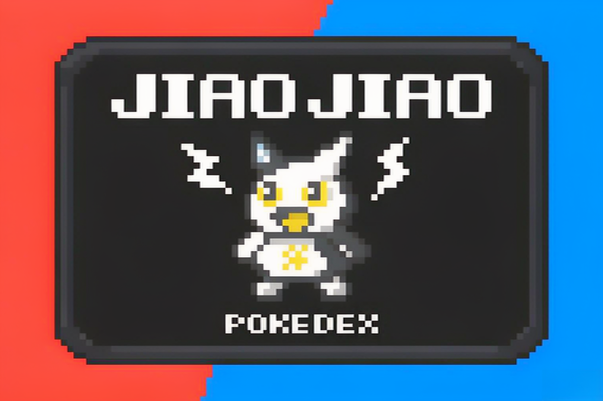

<div align="center">
  
</div>

```text
- 图鉴开机 -
> 训练家: jiaojiao
> 职业: 宝可梦大师
> 图鉴: 2 只宝可梦已收服，见下方
> 训练目标: 让数据开口说话

HP ▓▓▓░░  LV.2
```

<div align="center">
  
  
  
  
</div>

## 已收服的宝可梦

<table>
  <tr>
    <td width="50%">
      <div align="center">
        <br/><br/>
        <a href="https://github.com/jiaojiaosr4/First-Internship-Portfolio">
          
        </a>
      </div>
    </td>
    <td width="50%">
      <div align="center">
        <br/><br/>
        <a href="https://github.com/jiaojiaosr4/shortdrama-monetization-research">
          
        </a>
      </div>
    </td>
  </tr>
</table>

## 属性图鉴

<div align="center">
  <a href="https://github.com/jiaojiaosr4">
    
  </a>
</div>

## 野外出现中

<div align="center">
  <picture>
    
  </picture>
</div>

```text
想交换图鉴? > mail jiaojiaosr4@gmail.com
```
